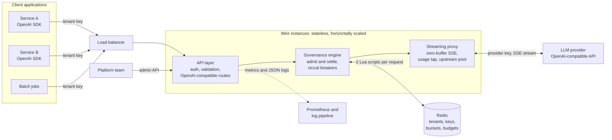
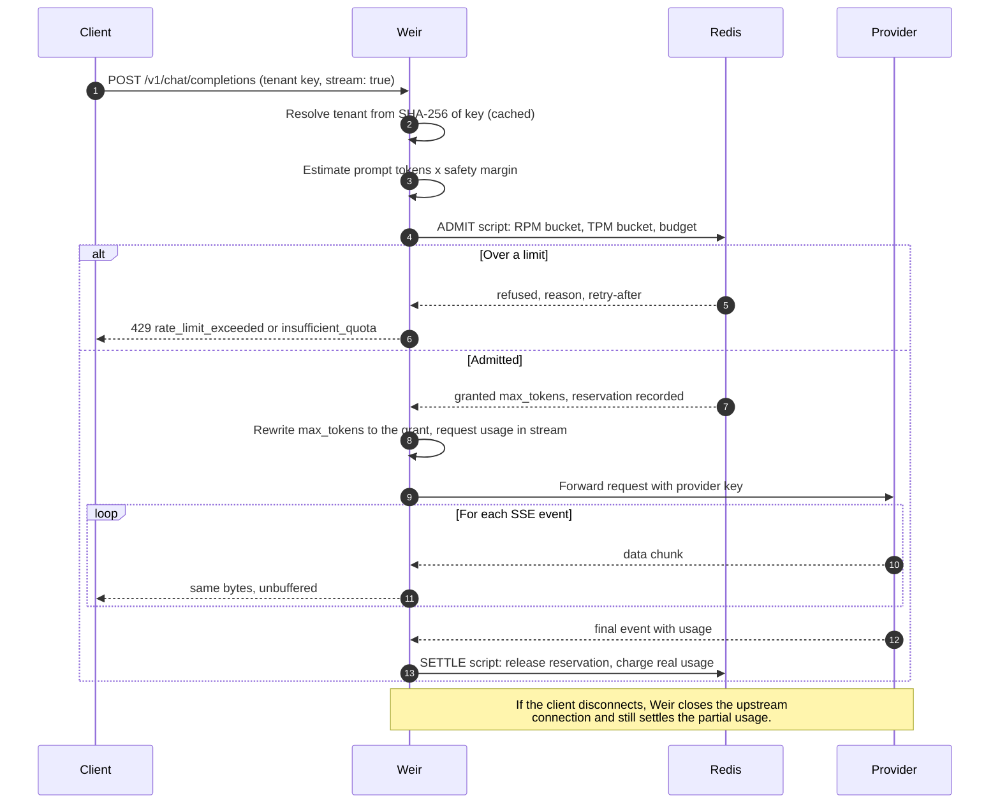
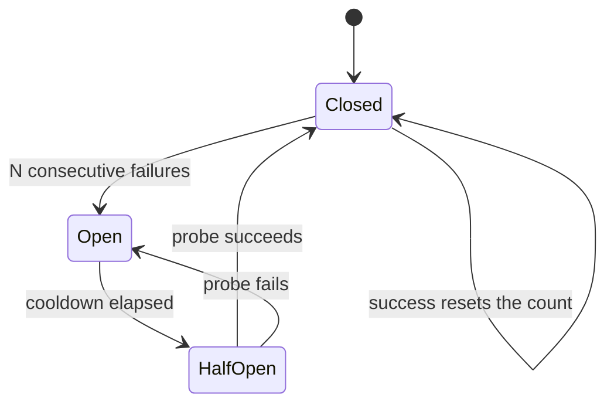

<div align="center">

# Weir

### Let tokens through. Hold the budget.

An OpenAI-compatible LLM gateway that gives every team its own key, rate limits and a hard token budget, enforced atomically across any number of instances, with zero-buffer streaming.

[](https://github.com/valentinakiyungi/weir/actions/workflows/ci.yml)
[](https://www.python.org/downloads/)
[](https://fastapi.tiangolo.com/)
[](https://redis.io/)
[](LICENSE)

[**Website & live demo**](https://valentinakiyungi.github.io/weir/) &nbsp;·&nbsp; [Quickstart](#quickstart) &nbsp;·&nbsp; [Architecture](#architecture) &nbsp;·&nbsp; [API](#api-reference) &nbsp;·&nbsp; [Benchmarks](#performance)

</div>

---

## Contents

- [Why Weir](#why-weir)
- [Features](#features)
- [Architecture](#architecture)
- [Quickstart](#quickstart)
- [API reference](#api-reference)
- [Configuration](#configuration)
- [Observability](#observability)
- [Performance](#performance)
- [Testing](#testing)
- [Project structure](#project-structure)
- [Deployment](#deployment)
- [Limitations and roadmap](#limitations-and-roadmap)
- [License](#license)

---

## Why Weir

> A weir is a low dam across a river. Water keeps flowing over it, but the level upstream stays where you set it. Weir does the same for LLM tokens.

When applications call an LLM provider directly, every team shares one provider key, nobody has per-team limits, and runaway spend shows up on the invoice a month later. A naive limiter that checks "is usage under budget?" before each call and records cost afterwards doesn't help much either: under concurrent load every in-flight request passes the check before any of them is charged. In our burst test that overspent the budget by **40.6%**.

Weir sits between your applications and any OpenAI-compatible provider. It reserves the worst-case cost of each request *before* calling the provider, lowers `max_tokens` to whatever budget remains, and settles against the provider's real usage afterwards. The same burst stays at **0.0%** over budget.

Applications keep using the official OpenAI SDKs. Only the base URL and the key change.

## Features

| | |
|---|---|
| **Multi-tenant keys** | Each team gets its own gateway keys, stored only as SHA-256 digests. The provider key never leaves the gateway. |
| **Atomic rate limits** | Requests-per-minute and tokens-per-minute token buckets, evaluated in a single Redis Lua script, consistent across every instance. |
| **Hard token budgets** | Daily or monthly budgets with up-front reservations. No overrun under concurrency, by construction. |
| **Budget-aware clamping** | When the remaining budget can't cover the requested `max_tokens`, the request is rewritten to fit instead of being refused. |
| **Zero-buffer SSE** | Provider bytes are forwarded as they arrive. Usage is read from the stream without holding it. |
| **Disconnect-safe billing** | If a client hangs up mid-stream, generation is cancelled upstream and the partial usage is still charged. |
| **Fail-open by design** | Circuit breakers on Redis and the provider. If Redis fails, known tenants keep being served under a local rate guard. |
| **Drop-in compatibility** | OpenAI request and response formats, error schema and `x-ratelimit-*` headers, so existing SDK retry logic just works. |
| **Operable** | Admin API, Prometheus metrics, structured JSON logs, health and readiness probes, Docker image and Compose stack. |

---

## Architecture

### System context

Weir is stateless. Every instance can serve every tenant, and all shared state (tenants, keys, rate-limit buckets, budgets) lives in Redis. You scale it by adding workers or instances behind a load balancer.



### Request lifecycle

A governed streaming request makes exactly two Redis round trips. Each is a single Lua script, so it runs atomically and needs no locks.



### Budget accounting

The budget is protected by reserving worst-case cost at admission and correcting it at settlement. Per tenant, per period:

```text
remaining  = budget - used - reserved
estimate   = ceil(prompt_tokens_estimate * PROMPT_ESTIMATE_MARGIN)

admit:     refuse          if remaining < estimate + MIN_COMPLETION_TOKENS
           granted_tokens  = min(requested_max_tokens, remaining - estimate)
           reserved       += estimate + granted_tokens

settle:    reserved       -= estimate + granted_tokens
           used           += actual_prompt_tokens + actual_completion_tokens
```

Because concurrent requests reserve against the same counter inside one atomic script, the sum of in-flight worst cases can never exceed what's left. Rate limits use token buckets that refill continuously (`rpm/60` per second). The unused part of a TPM reservation is refunded at settlement, so long `max_tokens` values don't starve a tenant's throughput.

Two details keep this correct at scale:

- **Cluster-safe keys.** All of a tenant's rate-limit and budget keys share the Redis Cluster hash tag `{tenant}`, so both scripts touch a single slot.
- **One clock.** Scripts read time from Redis `TIME`, so gateway instances with skewed clocks still agree on bucket refills.

### Redis data model

| Key | Type | Contents | Expiry |
|---|---|---|---|
| `weir:tenant:<id>` | string | Tenant policy as JSON | none |
| `weir:tenants` | set | All tenant ids | none |
| `weir:key:<sha256>` | string | `tenant_id`, `key_id`, `created_at` | none |
| `weir:tenant_keys:<id>` | set | Key digests owned by the tenant | none |
| `weir:rl:{<id>}:rpm` | hash | Request bucket level and last refill time | 2 min idle |
| `weir:rl:{<id>}:tpm` | hash | Token bucket level and last refill time | 2 min idle |
| `weir:budget:{<id>}:<period>` | hash | `used`, `reserved`, `requests`, `prompt_tokens`, `completion_tokens` | period end + 7 days (daily) or + 62 days (monthly) |

### Resilience

Both external dependencies sit behind a circuit breaker. After a run of consecutive failures the breaker opens, and calls fail instantly instead of waiting on timeouts. After a cooldown, a single probe call decides whether to close it again.



| Failure | Behaviour |
|---|---|
| Redis slow or unreachable | 250 ms timeouts, then the breaker opens. With `FAIL_OPEN=true`, known tenants are served under a per-process RPM guard and responses carry `x-weir-degraded: 1`. With `FAIL_OPEN=false`, requests get 503. |
| Unknown key during a Redis outage | 503. Fail-open never serves unauthenticated traffic. |
| Provider returns 4xx or 5xx | Status and body pass through unchanged. The reservation is released and nothing is charged. |
| Provider unreachable or timing out | OpenAI-style 502 or 504. After repeated failures the upstream breaker answers 503 immediately. |
| Client disconnects mid-stream | Upstream connection closed, which stops generation. Partial usage charged, reservation released. |
| Provider stream breaks mid-way | The client receives a final `data: {"error": ...}` event. Partial usage charged. |

### Design decisions

| Decision | Why |
|---|---|
| Lua scripts instead of pipelines or locks | A check and its update must be one atomic step, or concurrent instances race. Lua gives that in one round trip. |
| Reserve first, settle later | Charging after the response can't stop concurrent overspend. Reserving the worst case can. |
| Clamp instead of refuse | A smaller answer is usually more useful than a 429 when a team is near its limit. |
| Fail open with a local guard | A limiter outage shouldn't take every AI feature offline, but it shouldn't remove all limits either. |
| Custom HTTP/1.1 transport for httpx | httpx's default pool does work proportional to open connections on every request and collapses at thousands of concurrent streams. The built-in transport keeps the httpx API with constant-time pooling. See [Performance](#performance). |
| Stateless instances | Any instance can be killed or added at any time. Scaling is a replica count. |

---

## Quickstart

### With Docker Compose

Starts Weir, Redis and a mock OpenAI-compatible provider, so no API key is needed.

```bash
git clone https://github.com/valentinakiyungi/weir.git
cd weir
docker compose up --build
```

```bash
curl -N localhost:8000/v1/chat/completions \
  -H "Authorization: Bearer weir-acme-dev-key" \
  -d '{"model":"gpt-4o-mini","stream":true,"max_tokens":20,
       "messages":[{"role":"user","content":"Hello"}]}'
```

To front a real provider:

```bash
UPSTREAM_BASE_URL=https://api.openai.com/v1 UPSTREAM_API_KEY=sk-... docker compose up --build
```

### Without Docker

Requires Python 3.11+ and a local Redis.

```bash
python3 -m venv .venv && source .venv/bin/activate
pip install -e ".[dev]"
redis-server --daemonize yes

# Terminal 1: mock provider
uvicorn mock_upstream.server:app --port 9000

# Terminal 2: gateway
export UPSTREAM_BASE_URL=http://localhost:9000/v1
export TENANTS_FILE=config/tenants.example.json
export ADMIN_API_KEY=change-me
weir        # or: uvicorn weir.main:app --port 8000 --workers 2
```

### From the OpenAI SDK

```python
from openai import OpenAI

client = OpenAI(base_url="http://localhost:8000/v1", api_key="weir-acme-dev-key")

stream = client.chat.completions.create(
    model="gpt-4o-mini",
    stream=True,
    messages=[{"role": "user", "content": "Write a haiku about rate limits"}],
)
for chunk in stream:
    if chunk.choices:
        print(chunk.choices[0].delta.content or "", end="")
```

---

## API reference

### Data plane

OpenAI-compatible. Authenticate with `Authorization: Bearer <tenant key>` or `x-api-key: <tenant key>`.

| Method | Path | Description |
|---|---|---|
| `POST` | `/v1/chat/completions` | Chat completions, streaming and non-streaming. Governed. |
| `POST` | `/v1/embeddings` | Embeddings. Governed on input tokens. |
| `GET` | `/v1/models` | Provider models, filtered to the tenant's `allowed_models`. |

**Response headers** on every governed request:

| Header | Meaning |
|---|---|
| `x-request-id` | Request id, also forwarded upstream |
| `x-weir-tenant` | Resolved tenant id |
| `x-ratelimit-limit-requests`, `x-ratelimit-remaining-requests` | RPM limit and what's left |
| `x-ratelimit-limit-tokens`, `x-ratelimit-remaining-tokens` | TPM limit and what's left |
| `x-weir-budget-remaining` | Tokens left in the current budget period |
| `x-weir-max-tokens` | Completion tokens granted (may be lower than requested) |
| `x-weir-degraded` | `1` when served in fail-open mode |

**Errors** use the OpenAI error schema:

| Status | `code` | When |
|---|---|---|
| 401 | `missing_api_key`, `invalid_api_key` | No key, or an unknown key |
| 403 | `tenant_disabled`, `model_not_allowed` | Tenant disabled, or model not on its allow-list |
| 429 | `rate_limit_exceeded` | RPM or TPM exceeded. `Retry-After` gives the wait in seconds. |
| 429 | `insufficient_quota` | Budget spent. `Retry-After` is the time until the period resets. |
| 502, 504 | `upstream_unreachable`, `upstream_timeout` | Provider can't be reached |
| 503 | `upstream_unavailable`, `governance_unavailable` | Breaker open, or Redis down with `FAIL_OPEN=false` |

### Control plane

Authenticate with `Authorization: Bearer $ADMIN_API_KEY`. The admin API is disabled when `ADMIN_API_KEY` is unset.

| Method | Path | Description |
|---|---|---|
| `POST` | `/admin/tenants` | Create a tenant. Returns its first key, shown once. |
| `GET` | `/admin/tenants` | List tenants |
| `GET` | `/admin/tenants/{id}` | Get a tenant |
| `PATCH` | `/admin/tenants/{id}` | Update `name`, `enabled`, `rpm`, `tpm`, `token_budget`, `max_tokens_cap`, `allowed_models` |
| `DELETE` | `/admin/tenants/{id}` | Delete a tenant and all its keys |
| `POST` | `/admin/tenants/{id}/keys` | Issue an additional key |
| `GET` | `/admin/tenants/{id}/keys` | List keys (ids only) |
| `DELETE` | `/admin/tenants/{id}/keys/{key_id}` | Revoke a key |
| `GET` | `/admin/tenants/{id}/usage?period=YYYYMMDD` | Usage, in-flight reservations and remaining budget |

```bash
curl -X POST localhost:8000/admin/tenants \
  -H "Authorization: Bearer $ADMIN_API_KEY" \
  -d '{"id": "search-team", "rpm": 120, "tpm": 200000,
       "token_budget": 2000000, "allowed_models": ["gpt-4o-mini"]}'
```

Tenants can also be seeded at startup from `TENANTS_FILE` (see [`config/tenants.example.json`](config/tenants.example.json)). Seeding never overwrites a tenant that already exists, so changes made through the API survive restarts. A limit of `0` means unlimited.

---

## Configuration

All settings are read from environment variables or a `.env` file. See [`.env.example`](.env.example).

| Variable | Default | Description |
|---|---|---|
| **Upstream** | | |
| `UPSTREAM_BASE_URL` | `https://api.openai.com/v1` | Any OpenAI-compatible base URL |
| `UPSTREAM_API_KEY` | | Provider key, injected by the gateway |
| `UPSTREAM_TRANSPORT` | `fast` | `fast` (built-in streaming transport) or `httpx` (stock httpcore) |
| `UPSTREAM_MAX_CONNECTIONS` | `4096` | Upstream connection cap per worker |
| `UPSTREAM_READ_TIMEOUT` | `120` | Seconds between bytes before a stream is abandoned |
| **Governance** | | |
| `REDIS_URL` | `redis://localhost:6379/0` | Governance store |
| `FAIL_OPEN` | `true` | Keep serving known tenants when Redis is unavailable |
| `REDIS_SOCKET_TIMEOUT` | `0.25` | Seconds before a Redis call counts as failed |
| `REDIS_BREAKER_THRESHOLD` | `5` | Consecutive failures that open the Redis breaker |
| `REDIS_BREAKER_RECOVERY_SECONDS` | `5` | Cooldown before a probe call |
| `BUDGET_PERIOD` | `day` | `day` or `month`, in UTC |
| `DEFAULT_MAX_TOKENS` | `1024` | Reserved and injected when a request has no `max_tokens` |
| `ENFORCE_MAX_TOKENS` | `true` | Always send the granted cap upstream |
| `MIN_COMPLETION_TOKENS` | `16` | Smallest grant before a request is refused as over budget |
| `PROMPT_ESTIMATE_MARGIN` | `1.2` | Safety multiplier on prompt-token estimates |
| `INJECT_STREAM_USAGE` | `true` | Ask the provider for usage on streams, for exact metering |
| **Tenants and admin** | | |
| `TENANTS_FILE` | | JSON file of tenants to seed at startup |
| `ADMIN_API_KEY` | | Enables the admin API |
| `TENANT_CACHE_TTL` | `10` | Seconds a key lookup is cached per worker |
| **Server** | | |
| `PORT` | `8000` | Listen port (container) |
| `WORKERS` | `2` | Uvicorn worker processes (container) |
| `LOG_LEVEL` | `INFO` | Log level |

---

## Observability

| Endpoint | Purpose |
|---|---|
| `GET /health` | Liveness. Always 200 while the process is up. |
| `GET /ready` | Readiness. Reports Redis and breaker state. Returns 503 only when Redis is down and `FAIL_OPEN=false`. |
| `GET /metrics` | Prometheus metrics |

Key metrics:

| Metric | Labels | Description |
|---|---|---|
| `weir_requests_total` | `tenant`, `route`, `status` | Requests handled |
| `weir_rejections_total` | `tenant`, `reason` | Requests refused by governance |
| `weir_tokens_total` | `tenant`, `kind` | Tokens charged (prompt, completion) |
| `weir_max_tokens_clamped_total` | `tenant` | Requests whose `max_tokens` was lowered |
| `weir_governance_seconds` | | Auth and admission latency |
| `weir_upstream_ttfb_seconds` | | Provider time to response headers |
| `weir_active_streams` | | Open SSE streams |
| `weir_breaker_state` | `breaker` | 0 closed, 1 half-open, 2 open |
| `weir_degraded_admissions_total` | | Requests served in fail-open mode |

Each request also produces one JSON log line with tenant, model, status, prompt and completion tokens, reservation, degraded flag and duration.

---

## Performance

All figures were measured with the scripts in [`scripts/`](scripts), with the gateway (2 uvicorn workers, uvloop and httptools), Redis, the mock provider and the load generator sharing **one 2-vCPU machine**. Dedicated hardware will do better.

### Latency at 2,000 concurrent streams

Gateway compared with calling the provider directly. Each stream is held open for about 5 seconds. Ranges cover three runs of 6,000 streams; every run completed with zero errors.

| Added latency | p50 | p95 | p99 |
|---|---|---|---|
| Time to first token | +6 to 8 ms | +34 to 67 ms | +54 to 127 ms |
| Total stream time | +10 to 16 ms | +34 to 80 ms | +59 to 141 ms |

### Throughput per worker

One worker, 1,000 concurrent streams, each at 10 tokens per second.

| Upstream client | SSE events/s | Time for 2,000 streams |
|---|---|---|
| Single default `httpx.AsyncClient` | ~250 | 181 s |
| httpx sharded over 16 clients (`UPSTREAM_TRANSPORT=httpx`) | ~3,100 | 14.8 s |
| **Weir transport** (`UPSTREAM_TRANSPORT=fast`, default) | **~4,700** | **9.9 s** |

Two workers on the same contended machine reach about 7,300 events/s. Capacity scales with workers and instances.

### Budget overrun under bursts

600 streaming requests of up to 64 completion tokens against a 20,000-token budget.

| Limiter | 20 concurrent | 100 concurrent |
|---|---|---|
| None | +146.0% | +146.0% |
| Check, then charge | +7.8% | +40.6% |
| **Weir (reserve, clamp, settle)** | **+0.0%** | **+0.0%** |

At 100 concurrent requests Weir spends 29% less than check-then-charge while holding the budget exactly.

### Reproducing

```bash
# Latency and throughput
python scripts/fast_upstream.py --port 9200 --token-delay-ms 500 --tokens 10 &
UPSTREAM_BASE_URL=http://127.0.0.1:9200/v1 TENANTS_FILE=config/tenants.example.json \
  uvicorn weir.main:app --port 8000 --workers 2 --no-access-log &
python scripts/loadtest.py --compare http://127.0.0.1:9200/v1 --url http://127.0.0.1:8000/v1 \
  --key weir-loadtest-dev-key --concurrency 2000 --rounds 3 --max-tokens 10 --ramp 5

# Budget overrun (gateway pointed at mock_upstream, ADMIN_API_KEY=change-me)
python scripts/budget_burst.py --url http://127.0.0.1:8000 --admin-key change-me \
  --budget 20000 --requests 600 --concurrency 100
```

---

## Testing

```bash
pip install -e ".[dev]"
pytest -q          # starts a throwaway redis-server, or set TEST_REDIS_URL
ruff check .
```

The 44 tests run against a real Redis, because the Lua scripts are the core of the system, and against real uvicorn servers for streaming. They cover:

- authentication, disabled tenants and model allow-lists
- RPM and TPM limits, including atomicity under 40 concurrent requests
- budget clamping, exhaustion, and zero overrun under a 100-request burst
- provider errors, unreachable providers and circuit breaking
- incremental chunk delivery and settlement after client disconnects
- Redis outages in fail-open and fail-closed modes, and recovery
- the admin lifecycle
- the HTTP transport: keep-alive reuse, stale-connection retry, timeouts, chunked and close-delimited bodies, TLS

CI runs the suite on Python 3.11, 3.12 and 3.13, then builds the Docker image and smoke-tests the Compose stack.

---

## Project structure

```text
weir/
├── src/weir/
│   ├── main.py              App factory, lifespan, health, readiness, metrics
│   ├── api/
│   │   ├── v1.py            OpenAI-compatible routes and SSE passthrough
│   │   ├── admin.py         Tenant, key and usage control plane
│   │   ├── deps.py          Authentication and request parsing
│   │   └── errors.py        OpenAI-style error responses
│   ├── core/
│   │   ├── config.py        Settings
│   │   ├── circuit.py       Circuit breaker
│   │   ├── redis.py         Redis client behind a breaker
│   │   └── logging.py       Structured JSON logging
│   └── services/
│       ├── limiter.py       Admit and settle Lua scripts, fail-open governor
│       ├── tenants.py       Tenant registry, hashed keys, cache
│       ├── proxy.py         Upstream client and SSE usage tap
│       ├── transport.py     Streaming-optimised HTTP/1.1 transport for httpx
│       ├── tokens.py        Prompt token estimation
│       └── metrics.py       Prometheus metrics
├── mock_upstream/           OpenAI-compatible mock provider
├── scripts/                 Load test, fast upstream, budget burst benchmark
├── config/                  Example tenant seed file
├── site/                    Project website (GitHub Pages)
├── tests/                   Test suite
├── Dockerfile               Multi-stage, non-root image with health check
└── docker-compose.yml       Weir, Redis and the mock provider
```

---

## Deployment

**Container.** The image runs as a non-root user with a health check. Configure it entirely through environment variables and scale by replica count; instances share nothing but Redis.

```bash
docker build -t weir .
docker run -p 8000:8000 \
  -e REDIS_URL=redis://redis:6379/0 \
  -e UPSTREAM_API_KEY=sk-... \
  -e ADMIN_API_KEY=... \
  weir
```

**Redis.** Use Redis 7+ with persistence enabled and `maxmemory-policy noeviction`, so budget counters are never evicted. Redis Cluster is supported through hash-tagged keys.

**Website.** [`site/index.html`](site/index.html) is a static page with an in-browser simulation of the gateway. The [`pages`](.github/workflows/pages.yml) workflow publishes it on every push to `main` that changes `site/`. One-time setup: **Settings → Pages → Source: GitHub Actions**.

---

## Limitations and roadmap

Current limitations:

- Supports OpenAI-compatible chat completions, embeddings and models. Anthropic-native and Responses API routes are not implemented yet.
- Budgets hold exactly when the provider reports usage, as OpenAI and most compatible servers do. Otherwise Weir charges its own estimate.
- Tenant changes reach other instances within `TENANT_CACHE_TTL` seconds.
- If an instance is killed between admit and settle, its in-flight reservation stays counted until the period key expires.
- Prometheus metrics are per worker process. Scrape each worker, or run one worker per container.

Planned:

- Additional provider adapters and per-tenant routing across providers
- Reservation leases that expire automatically after an instance crash
- Cost budgets in currency alongside token budgets
- A small admin dashboard

---

## License

Released under the [MIT License](LICENSE).
