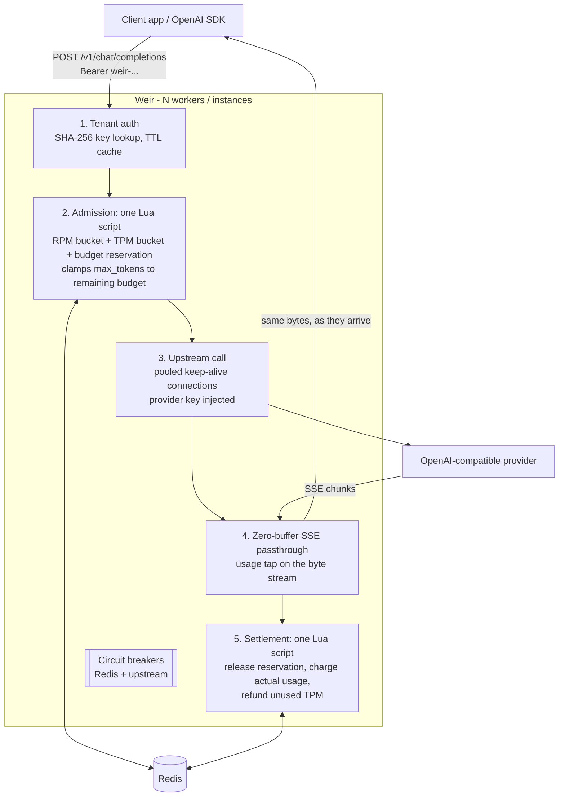

<div align="center">

# Weir

**Weir lets tokens through, never past the budget. An asynchronous, OpenAI-compatible LLM gateway with multi-tenant token governance, atomic Redis rate limiting, zero-buffer SSE streaming and fail-open circuit breaking.**

[](https://www.python.org/downloads/)
[](https://fastapi.tiangolo.com/)
[](https://redis.io/)
[](https://opensource.org/licenses/MIT)

**[Website & live demo](https://valentinakiyungi.github.io/weir/)**

</div>

---

## Overview

*A weir is a low dam across a river: water keeps flowing over it, but the level upstream is held where you set it. That is the job here, with tokens instead of water.*

Applications that call LLM APIs directly share one provider key, have no per-team limits, and only find out about runaway spend on the invoice. Weir sits between your applications and any OpenAI-compatible provider and gives each tenant:

- **Its own gateway API key** – the provider key never leaves the gateway.
- **Requests-per-minute and tokens-per-minute limits**, enforced atomically across any number of gateway instances.
- **A hard token budget per day or month** that cannot be overrun by concurrent bursts: worst-case cost is *reserved* before the call and `max_tokens` is clamped to what is left.
- **Byte-for-byte SSE streaming** with nothing buffered, while usage is still metered exactly.
- **Availability first**: if Redis goes down, traffic keeps flowing (with a local per-process rate guard) instead of taking every AI feature offline.

Clients keep using the official OpenAI SDKs – only the base URL and key change.

---

## Architecture & request lifecycle



### How token governance works

1. **Estimate** – prompt tokens are estimated locally (fast heuristic, `tiktoken` if installed) with a safety margin (`PROMPT_ESTIMATE_MARGIN`, default 1.2).
2. **Admit + reserve (atomic)** – a single Lua script checks the tenant's RPM token bucket, TPM token bucket and period budget, and reserves `prompt_estimate + max_tokens`. Nothing is committed unless every check passes, so a rejected request costs the tenant nothing.
3. **Clamp** – if the remaining budget can't cover the requested `max_tokens` but can cover at least `MIN_COMPLETION_TOKENS`, the grant is reduced and the gateway rewrites `max_tokens` before forwarding. The provider physically cannot generate past the budget. If the client sent no `max_tokens`, `DEFAULT_MAX_TOKENS` is injected (`ENFORCE_MAX_TOKENS=true`).
4. **Stream** – upstream bytes are forwarded as they arrive. The gateway asks the provider for usage (`stream_options.include_usage`) and a tap reads it from the final event without holding the stream.
5. **Settle (atomic)** – releases the reservation, charges the provider-reported usage, refunds the unused part of the TPM reservation and updates usage counters. This also runs, shielded from cancellation, when the client disconnects mid-stream: the upstream connection is closed (stopping generation) and the partial usage is billed.

All of a tenant's keys share a Redis Cluster hash tag (`weir:rl:{tenant}:…`) so the scripts are cluster-safe, and time is taken from Redis `TIME` so instances with skewed clocks still agree.

### Failure behaviour

| Failure | Behaviour |
|---|---|
| Redis slow/down | Breaker opens after `REDIS_BREAKER_THRESHOLD` failures (tight 250 ms timeouts), then calls short-circuit instantly. With `FAIL_OPEN=true` known tenants keep being served (seed file / cached tenants) under a **local per-process RPM guard**, responses carry `x-weir-degraded: 1`. `FAIL_OPEN=false` returns 503 instead. Half-open probes restore normal operation automatically. |
| Unknown key while Redis is down | 503 (can't authenticate) – fail-open never means unauthenticated. |
| Upstream 4xx/5xx | Status and body passed through unchanged; reservation released, nothing billed. |
| Upstream unreachable / timeout | OpenAI-style 502 / 504; after `UPSTREAM_BREAKER_THRESHOLD` consecutive failures the upstream breaker returns 503 immediately. |
| Client disconnects mid-stream | Upstream connection closed, partial usage billed, reservation released. |
| Upstream stream breaks mid-way | Client receives a final `data: {"error": …}` event; partial usage billed. |

---

## Quickstart

### 1. Run the full stack (gateway + Redis + mock provider)

```bash
git clone https://github.com/valentinakiyungi/weir.git
cd weir
docker compose up --build
```

```bash
curl -N localhost:8000/v1/chat/completions \
  -H "Authorization: Bearer weir-acme-dev-key" \
  -d '{"model":"gpt-4o-mini","stream":true,"messages":[{"role":"user","content":"hi"}],"max_tokens":20}'
```

To front a real provider: `UPSTREAM_BASE_URL=https://api.openai.com/v1 UPSTREAM_API_KEY=sk-... docker compose up --build`.

### 2. Run locally without Docker

```bash
python3 -m venv .venv && source .venv/bin/activate
pip install -e ".[dev]"
redis-server --daemonize yes

# terminal 1: mock provider
uvicorn mock_upstream.server:app --port 9000

# terminal 2: gateway
export UPSTREAM_BASE_URL=http://localhost:9000/v1 TENANTS_FILE=config/tenants.example.json ADMIN_API_KEY=change-me
weir                   # or: uvicorn weir.main:app --port 8000 --workers 2
```

### 3. Use it from the OpenAI SDK

```python
from openai import OpenAI

client = OpenAI(base_url="http://localhost:8000/v1", api_key="weir-acme-dev-key")
for chunk in client.chat.completions.create(
    model="gpt-4o-mini", stream=True,
    messages=[{"role": "user", "content": "Write a haiku about rate limits"}],
):
    if chunk.choices:
        print(chunk.choices[0].delta.content or "", end="")
```

---

## API

### Data plane (OpenAI-compatible)

| Method | Path | Notes |
|---|---|---|
| POST | `/v1/chat/completions` | Streaming and non-streaming. Governed. |
| POST | `/v1/embeddings` | Governed (input tokens). |
| GET | `/v1/models` | Filtered to the tenant's `allowed_models`. |

Auth: `Authorization: Bearer <gateway key>` or `x-api-key: <gateway key>`.
Every governed response carries:

```
x-request-id, x-weir-tenant
x-ratelimit-limit-requests / x-ratelimit-remaining-requests
x-ratelimit-limit-tokens   / x-ratelimit-remaining-tokens
x-weir-budget-remaining, x-weir-max-tokens (the granted completion cap)
x-weir-degraded: 1      (only when served in fail-open mode)
```

Rejections use the OpenAI error schema so SDK retry logic works: `429 rate_limit_exceeded` (RPM/TPM, with `Retry-After`) and `429 insufficient_quota` (budget exhausted, `Retry-After` = seconds until the period resets).

### Control plane (`Authorization: Bearer $ADMIN_API_KEY`)

| Method | Path | |
|---|---|---|
| POST | `/admin/tenants` | Create; returns the first API key **once** |
| GET | `/admin/tenants`, `/admin/tenants/{id}` | List / get |
| PATCH | `/admin/tenants/{id}` | Change `rpm`, `tpm`, `token_budget`, `max_tokens_cap`, `allowed_models`, `enabled`, `name` |
| DELETE | `/admin/tenants/{id}` | Delete tenant and all keys |
| POST / GET | `/admin/tenants/{id}/keys` | Issue / list keys (only `key_id` prefixes are stored) |
| DELETE | `/admin/tenants/{id}/keys/{key_id}` | Revoke |
| GET | `/admin/tenants/{id}/usage?period=YYYYMMDD` | Used, in-flight reservations, remaining, request & token counters |

```bash
curl -X POST localhost:8000/admin/tenants -H "Authorization: Bearer change-me" \
  -d '{"id":"search-team","rpm":120,"tpm":200000,"token_budget":2000000,"allowed_models":["gpt-4o-mini"]}'
```

Tenants can also be seeded from `TENANTS_FILE` (see `config/tenants.example.json`). Seeding never overwrites a tenant already in Redis, so edits made through the API survive restarts. Keys are only ever stored as SHA-256 digests.

### Ops

`GET /health` (liveness), `GET /ready` (Redis + breaker state; 503 only when fail-closed and Redis is down), `GET /metrics` (Prometheus: requests, rejections by reason, billed tokens, clamped requests, governance latency histogram, upstream TTFB, active streams, breaker states, degraded admissions). Logs are one JSON line per request with tenant, model, status, tokens, reservation and duration.

---

## Configuration

All settings are environment variables (or `.env`); see `.env.example`.

| Variable | Default | Purpose |
|---|---|---|
| `UPSTREAM_BASE_URL` | `https://api.openai.com/v1` | Any OpenAI-compatible base URL |
| `UPSTREAM_API_KEY` | – | Provider key, injected by the gateway |
| `UPSTREAM_TRANSPORT` | `fast` | `fast` (built-in SSE-tuned transport) or `httpx` (stock httpcore) |
| `UPSTREAM_MAX_CONNECTIONS` | `4096` | Upstream connection cap per worker |
| `REDIS_URL` | `redis://localhost:6379/0` | Governance store |
| `FAIL_OPEN` | `true` | Serve (with local RPM guard) when Redis is unavailable |
| `REDIS_SOCKET_TIMEOUT` | `0.25` | Seconds; keeps a sick Redis from stalling requests |
| `REDIS_BREAKER_THRESHOLD` / `_RECOVERY_SECONDS` | `5` / `5` | Breaker tuning |
| `BUDGET_PERIOD` | `day` | `day` or `month` (UTC) |
| `DEFAULT_MAX_TOKENS` | `1024` | Reserved and injected when a request has no `max_tokens` |
| `ENFORCE_MAX_TOKENS` | `true` | Always send the granted cap upstream |
| `MIN_COMPLETION_TOKENS` | `16` | Smallest clamped grant before rejecting as budget exhausted |
| `PROMPT_ESTIMATE_MARGIN` | `1.2` | Safety multiplier on prompt estimates |
| `INJECT_STREAM_USAGE` | `true` | Request `include_usage` on streams for exact metering |
| `TENANTS_FILE` | – | JSON seed file |
| `ADMIN_API_KEY` | – | Enables the admin API |
| `TENANT_CACHE_TTL` | `10` | Seconds a key→tenant lookup is cached per worker |
| `WORKERS` / `PORT` | `2` / `8000` | Container entrypoint |

---

## Performance

Numbers below were measured with the scripts in `scripts/`, all processes on **one 2-vCPU VM** (gateway, Redis, upstream and load generator competing for the same two cores), gateway with 2 uvicorn workers, uvloop + httptools.

**Concurrent streaming** – `scripts/loadtest.py` against `scripts/fast_upstream.py` (50 ms TTFT, 10 tokens at 2 tokens/s, so every stream is held open ~5 s), 2,000 concurrent connections, 3 rounds, compared with hitting the upstream directly:

| | p50 | p95 | p99 |
|---|---|---|---|
| Added time-to-first-token (3 runs) | +6 – 8 ms | +34 – 67 ms | +54 – 127 ms |
| Added total stream time (3 runs) | +10 – 16 ms | +34 – 80 ms | +59 – 141 ms |

6,000/6,000 streams completed, 2,000 peak concurrent, 0 errors. Each request performs two Redis Lua round trips and a full auth/governance pass. On hardware where the load generator and upstream don't share the gateway's CPUs, overhead is lower.

**Per-worker throughput** – one worker, 1,000 concurrent streams at 10 tokens/s each (`--token-delay-ms 100 --tokens 20`):

| Upstream client | SSE events/s forwarded | Wall time for 2,000 streams |
|---|---|---|
| Single default `httpx.AsyncClient` (what most proxies do) | ~250 | 181 s |
| httpx, connections sharded over 16 clients (`UPSTREAM_TRANSPORT=httpx`) | ~3,100 | 14.8 s |
| **Built-in SSE transport** (`UPSTREAM_TRANSPORT=fast`, default) | **~4,700** | **9.9 s** |

httpcore's pool does O(n) bookkeeping per request plus an anyio cancel scope and h11 parse per read, which collapses at thousands of open streams. The built-in transport keeps the httpx API but pools in O(1) and reads straight from asyncio streams. Capacity scales out with workers and instances because all shared state lives in Redis (2 workers on the same contended box: ~7,300 events/s).

**Budget overrun under bursts** – `scripts/budget_burst.py`, 600 streaming requests of up to 64 completion tokens against a 20,000-token budget:

| Limiter | 20 concurrent | 100 concurrent |
|---|---|---|
| None | +146% | +146% |
| Check `used < budget`, charge after response | +7.8% | +40.6% |
| **Gateway reservations + clamping** | **+0.0%** | **+0.0%** (−29% spend vs check-then-charge) |

Reproduce:

```bash
python scripts/fast_upstream.py --port 9200 --token-delay-ms 500 --tokens 10 &
UPSTREAM_BASE_URL=http://127.0.0.1:9200/v1 TENANTS_FILE=config/tenants.example.json \
  uvicorn weir.main:app --port 8000 --workers 2 --no-access-log &
python scripts/loadtest.py --compare http://127.0.0.1:9200/v1 --url http://127.0.0.1:8000/v1 \
  --key weir-loadtest-dev-key --concurrency 2000 --rounds 3 --max-tokens 10 --ramp 5

python scripts/budget_burst.py --url http://127.0.0.1:8000 --admin-key change-me \
  --budget 20000 --requests 600 --concurrency 100   # gateway pointed at mock_upstream
```

---

## Project layout

```text
weir/
├── src/weir/
│   ├── main.py              # app factory, lifespan, /health /ready /metrics
│   ├── api/
│   │   ├── v1.py            # OpenAI-compatible routes, SSE passthrough
│   │   ├── admin.py         # tenant / key / usage control plane
│   │   ├── deps.py          # auth, body parsing
│   │   └── errors.py        # OpenAI-style error bodies
│   ├── core/
│   │   ├── config.py        # pydantic-settings
│   │   ├── circuit.py       # circuit breaker
│   │   ├── redis.py         # Redis client behind a breaker
│   │   └── logging.py       # JSON logs
│   └── services/
│       ├── limiter.py       # admit/settle Lua scripts, fail-open governor
│       ├── tenants.py       # tenant registry, hashed keys, cache
│       ├── proxy.py         # upstream client, SSE usage tap
│       ├── transport.py     # SSE-tuned HTTP/1.1 transport for httpx
│       ├── tokens.py        # prompt token estimation
│       └── metrics.py       # Prometheus metrics
├── mock_upstream/server.py  # OpenAI-compatible mock provider
├── site/index.html          # project website (deployed to GitHub Pages)
├── scripts/                 # loadtest, fast_upstream, budget_burst
├── config/tenants.example.json
├── tests/                   # 44 tests against real Redis + real sockets
├── Dockerfile               # multi-stage, non-root, healthcheck
└── docker-compose.yml       # gateway + Redis + mock provider
```

## Tests

```bash
pip install -e ".[dev]"
pytest -q          # starts a throwaway redis-server, or set TEST_REDIS_URL
ruff check .
```

The suite runs against a real Redis (the Lua scripts are the core of the system) and real uvicorn servers for streaming. It covers auth, model allow-lists, RPM/TPM limits including atomicity under 40 concurrent requests, budget clamping and exhaustion, zero overrun under a 100-request burst, upstream errors and circuit breaking, incremental chunk delivery, client-disconnect settlement, Redis outage in both fail-open and fail-closed modes and recovery, the admin lifecycle, and the HTTP transport (keep-alive reuse, stale-connection retry, timeouts, chunked/close-delimited bodies).

## Website

`site/index.html` is a single static page (no build step) with an in-browser simulation of the gateway. `.github/workflows/pages.yml` publishes it to GitHub Pages on every push to `main` that touches `site/`. One-time setup: **Settings → Pages → Build and deployment → Source: GitHub Actions**.

## Limitations

- OpenAI-compatible providers only (chat completions, embeddings, models). No Anthropic-native or Responses API routes yet.
- Prompt reservations are estimates; budgets hold exactly only when the provider reports usage (OpenAI and most compatible servers do). Without usage the gateway bills its own estimate.
- Tenant edits propagate to other instances within `TENANT_CACHE_TTL` seconds.
- If a gateway instance is killed between admit and settle, its in-flight reservation stays counted until the period key expires.
- Prometheus metrics are per worker process; scrape each worker or run one worker per container.

## License

MIT
